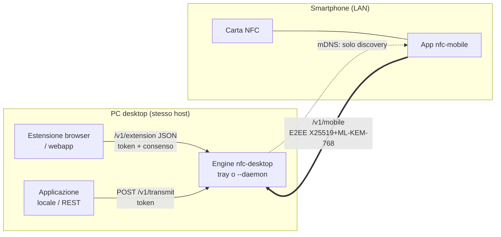
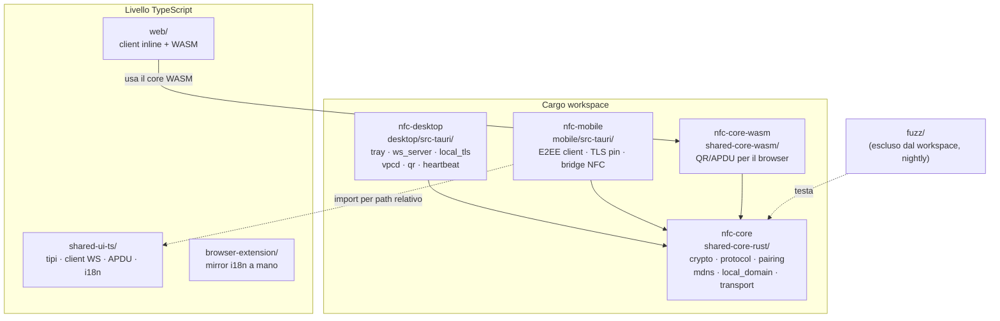
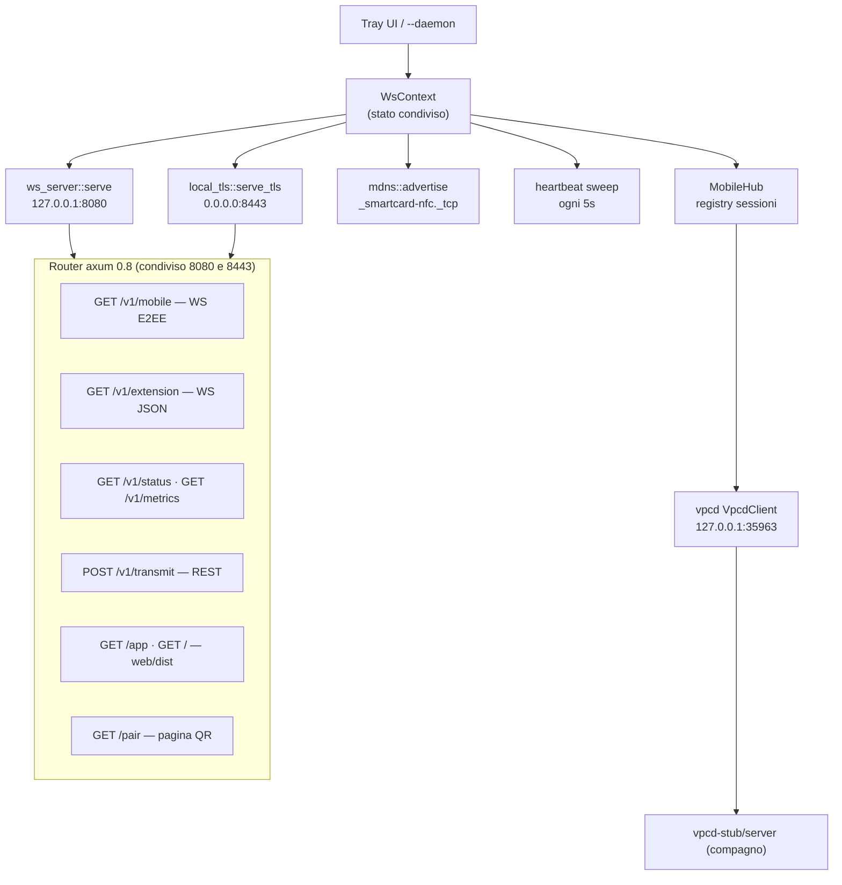
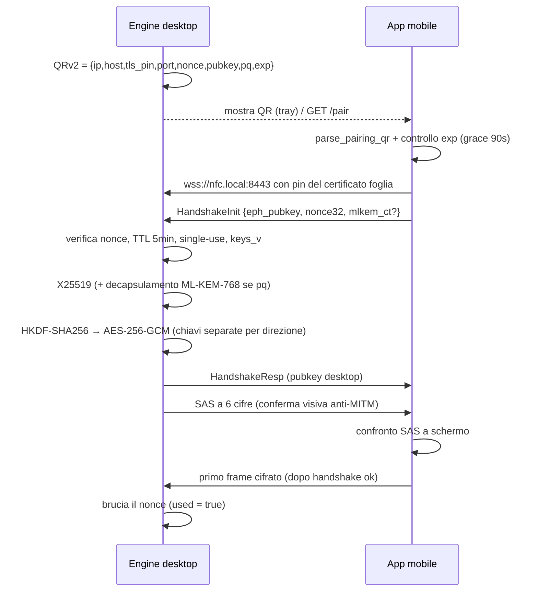
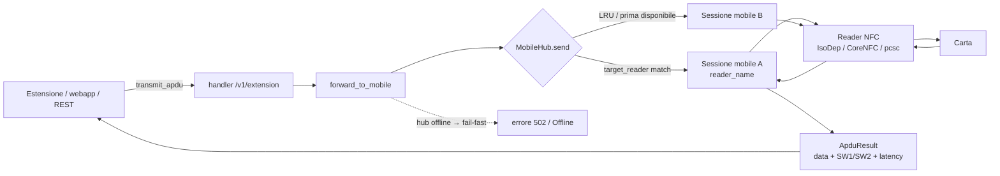
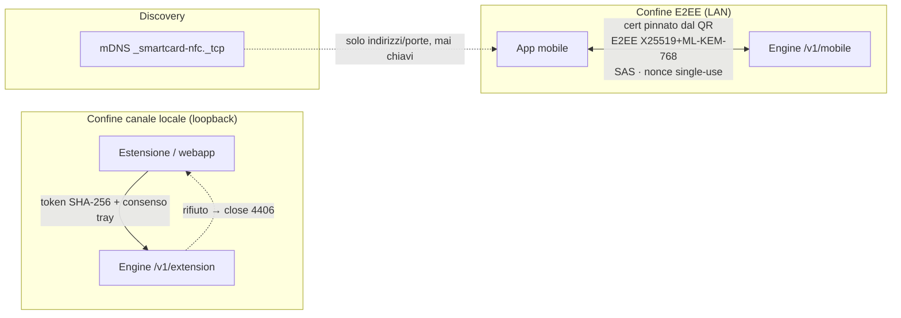

# Architettura di sistema — NFC Remote Smartcard

> Documento di architettura. Ogni affermazione è derivata dal codice; i percorsi
> `file:riga` puntano all'implementazione corrente. Il *cosa* sta nel codice, il
> *perché* delle scelte sta qui (e in `docs/SECURITY.md` / `docs/LOCAL-DOMAIN.md`).
> Per la spec sul filo vedi `docs/API_SPEC.md`; per la postura di sicurezza,
> `docs/SECURITY.md`.

---

## 1. Panoramica

Il sistema trasforma uno **smartphone in un lettore NFC remoto** per il PC: la
carta resta appoggiata al telefono, mentre l'applicazione sul desktop (estensione
browser, webapp o codice arbitrario via REST) inoltra gli APDU alla carta e ne
riceve la risposta.

Due canali distinti, con confini di fiducia diversi:

- **`/v1/mobile` (E2EE, binario prost)** — il telefono in LAN. Handshake
  `X25519` (+ `ML-KEM-768` ibrido) e cifratura end-to-end `AES-256-GCM`; il
  peer è autenticato dal materiale nel QR e confermato dalla **SAS**. Il
  trasporto è `wss://nfc.local:8443` con **pin del certificato foglia** letto
  dal QR (`desktop/src-tauri/src/ws_server.rs:995`, `mobile/src-tauri/src/lib.rs`).
- **`/v1/extension` (JSON)** — estensione e webapp sulla **stessa macchina**:
  primario su `wss://nfc.local:8443`, fallback in chiaro su `ws://127.0.0.1:8080`
  (loopback-only). Il confine è l'autenticazione per-client: **token** emesso solo
  con **consenso esplicito** nella tray; senza token il socket chiude con `4406`
  (`desktop/src-tauri/src/ws_server.rs:1385`, `desktop/src-tauri/src/local_auth.rs`).

---

## 2. Crate graph

Workspace Cargo (`Cargo.toml`, `resolver = "2"`): la logica crittografica e di
protocollo vive in **`nfc-core`** ed è riusata da desktop, mobile e WASM. Il crate
`fuzz/` è **escluso** dal workspace (`exclude = ["fuzz"]`) ed è nightly-only: non
entra in CI.

- `shared-ui-ts` è consumato **per path relativo** (es.
  `mobile/src/lib/secure-channel.ts` importa `../../../shared-ui-ts/src/...`), non
  come package pubblicato.
- `browser-extension` **duplica a mano** i18n e tipi (nessun bundler, `rootDir`
  chiuso): vedi `browser-extension/src/shared/i18n.ts:1`.
- `web/` ha un **client inline** e non importa `shared-ui-ts`; valida QR/APDU
  tramite il core WASM (`shared-core-wasm/src/lib.rs:46`).

---

## 3. Runtime desktop

L'engine (`nfc-desktop`) avvia task supervisionati (`desktop/src-tauri/src/lib.rs`):
WS in chiaro, WS TLS, mDNS, sweep heartbeat, ponte eventi verso la UI, adapter
vpcd. Il binario ha due modalità: tray (default) e `--daemon` headless
(`desktop/src-tauri/src/main.rs:1`).

- **8080 in chiaro**: bind **solo loopback**, hard-coded in `plain_bind_addr`
  (`desktop/src-tauri/src/ws_server.rs:713` → `SocketAddr::from(([127,0,0,1], port))`),
  con middleware che rifiuta i non-loopback (doppia difesa). È il fallback
  dell'estensione quando la CA locale non è fidata nel browser.
- **8443 TLS**: bind su `0.0.0.0` (`desktop/src-tauri/src/local_tls.rs:293`),
  quindi raggiungibile dal telefono in LAN; SAN `nfc.local`, `*.nfc.local`,
  `localhost` + IP (dettagli in `docs/LOCAL-DOMAIN.md`).
- **`/app`** serve `web/dist` (`desktop/src-tauri/src/ws_server.rs:401`,
  risoluzione della directory a `:509`); `/` è una landing JSON dei servizi.
- **vpcd** (`desktop/src-tauri/src/vpcd.rs`, porta `35963`): adapter PC/SC
  virtuale verso `vpcd`/vsmartcard; se il demone è giù l'engine serve comunque
  WS/extension (riconnessione esplicita con backoff). Il compagno `vpcd-stub`
  fornisce un server di test in-process (`desktop/src-tauri/src/vpcd_stub.rs`).

---

## 4. Sequenza di pairing

Il desktop espone un **QR v2** col materiale effimero: non esiste chiave statica
(`shared-core-rust/src/pairing.rs`). L'autorità sulla scadenza è l'engine
(`QR_TTL` = **5 minuti**, single-use); il campo `exp_unix` nel QR serve solo alla
diagnosi lato device.

Campi del payload (`PairingPayload`, `shared-core-rust/src/pairing.rs:20`):
`v`, `ip`, `port`, `nonce_b64`, `pubkey_b64`, `pq`, `mlkem_b64?`, `sas?`,
`host?`, `tls_pin_b64?`, `tls_port?`, `exp_unix?`.

- Deriva chiavi: `SessionKeys::derive` (classico) e `derive_hybrid`
  (`x25519_shared || mlkem_shared`) in `shared-core-rust/src/crypto.rs:116` e `:126`;
  HKDF-SHA256 con `salt = nonce32`, 64 byte divisi in due chiavi direzionali.
- **SAS**: `SHA256(pub_d || pub_m || nonce32)[0..3] mod 1_000_000`
  (`shared-core-rust/src/crypto.rs:275`).
- **Negoziato**: `pq:0` → classico; `pq:1` → ibrido. Un build senza feature `pq`
  rifiuta con `BUILD_SENZA_PQ` (`shared-core-rust/src/protocol.rs:39`).
- **Wire**: `EncryptedFrame` / `PlainFrame` (`HandshakeInit`, `HandshakeResp`,
  `ApduRequest`, `ApduResponse`, `CardEvent`) in `shared-core-rust/proto/smartcard.proto`.
- **Codici di chiusura stabili**: `4400`…`4406` (`shared-core-rust/src/protocol.rs:29`);
  il nonce è **single-use** e bruciato solo a handshake riuscito
  (`desktop/src-tauri/src/ws_server.rs:1005`, `:1084`).

---

## 5. Flusso APDU e routing

L'estensione/webapp (o REST) invia un APDU; l'engine lo inoltra alla sessione
mobile corretta attraverso il **`MobileHub`** (multi-sessione). La risposta
risale con gli `SW1/SW2` e la latenza.

- **Routing** (`desktop/src-tauri/src/ws_server.rs:193`): 1) se il job ha un
  `target_reader`, cerca la sessione con quel `reader_name`; 2) altrimenti **LRU**
  sulla sessione usata meno di recente; 3) fallback alla prima disponibile.
- **Fail-fast**: se l'hub è vuoto, `forward_to_mobile` ritorna subito "nessun
  lettore mobile connesso" e registra la metrica `Offline`
  (`desktop/src-tauri/src/ws_server.rs:1617`).
- **Heartbeat con grace**: ping ogni 5 s, `dead_after` 15 s
  (`shared-core-rust/src/transport.rs:19`); lo sweep transita
  `Online → Suspect → Offline` e al timeout deregistra la sessione
  (`desktop/src-tauri/src/heartbeat.rs`, `desktop/src-tauri/src/lib.rs:373`).
- **Lato device**: su Android/iOS il bridge nativo esegue il `transceive`
  (`mobile/gen/android/NfcIsoDepHandler.kt`, `mobile/gen/ios/NfcBridge.swift`);
  in timeout il core replica la risposta onesta `6F00` (vedi `mobile/gen/README.md`).

---

## 6. Trust boundaries

| Confine | Meccanismo | Dove |
| --- | --- | --- |
| E2EE mobile | Cert **pinnato** dal QR (`SHA-256(DER foglia)`), E2EE autorevole, SAS anti-MITM, nonce single-use | `shared-core-rust/src/pairing.rs:63`, `mobile/src-tauri/src/tls_pin.rs` |
| Canale locale | Token per-client salvato come **SHA-256**, consenso tray TTL 120 s, close `4406` | `desktop/src-tauri/src/local_auth.rs`, `shared-core-rust/src/protocol.rs:43` |
| Discovery | mDNS annuncia host/porte; **nessuno scambio di chiavi** | `shared-core-rust/src/mdns.rs:18` |

---

## 7. Invarianti di sicurezza 2026

- **TLS 1.3-only + `prefer-post-quantum`**: server config costruito con
  `with_protocol_versions(&[&rustls::version::TLS13])`
  (`desktop/src-tauri/src/local_tls.rs:276`); provider `aws-lc-rs` con
  `prefer-post-quantum` in entrambi i Cargo (`desktop/src-tauri/Cargo.toml:36`,
  `mobile/src-tauri/Cargo.toml:35`), gruppo `X25519MLKEM768` offerto per primo.
- **`unsafe_code` vietato** a livello di workspace (`Cargo.toml`, lints rust),
  con clippy `pedantic`.
- **Guard di sicurezza**: `scripts/guard-security-2026.sh` verifica a grep le
  proprietà cross-crate (TLS13/PQ, SHA-256 + tempo costante + `0600`, close
  `4406`, bind loopback 8080, MIME `application/wasm` + CSP `wasm-unsafe-eval`,
  `requireHttps` default `true` nell'estensione, `parsePairingQr` nella webapp).
- **Contratto pairing Rust↔TS**: `scripts/check-pairing-codes.mjs` verifica che i
  codici di `mobile/src-tauri/src/lib.rs` (`pub mod code`) combacino con le chiavi
  di `shared-ui-ts/src/i18n.ts` — una rinomina non produce errori di compilazione.
- **Niente downgrade su verifica TLS fallita**: il mobile interrompe, non ripiega
  sul canale in chiaro (`docs/SECURITY.md`).
- **Bind differenziato**: 8080 loopback-only (strutturale), 8443 esposto su LAN
  solo perché protetto dal pin + E2EE.

---

## 8. Build & test

I comandi completi e i prerequisiti sono in `README.md` e `AGENTS.md`; qui solo i
riferimenti essenziali, senza duplicarli.

- Rust (CI è autorevole): `cargo fmt --all --check`,
  `cargo test -p nfc-core -p nfc-desktop -p nfc-core-wasm --all-features`,
  `cargo clippy --workspace --all-features -- -D warnings`.
- Frontend: build per-subprogetto (`web/`, `browser-extension/`), ciascuno col
  proprio `package-lock.json`.
- Guard: `bash scripts/guard-security-2026.sh` (`SKIP_CLIPPY=1` per saltare il
  lint pesante quando clippy gira già a parte).
- E2E webapp: `bash scripts/test-webapp.sh` (Playwright contro l'engine reale).

Per il dettaglio di porte, domini e CA vedi `docs/LOCAL-DOMAIN.md`; per deploy e
upgrade, `docs/DEPLOYMENT.md` e `docs/UPGRADE-2026.md`.
