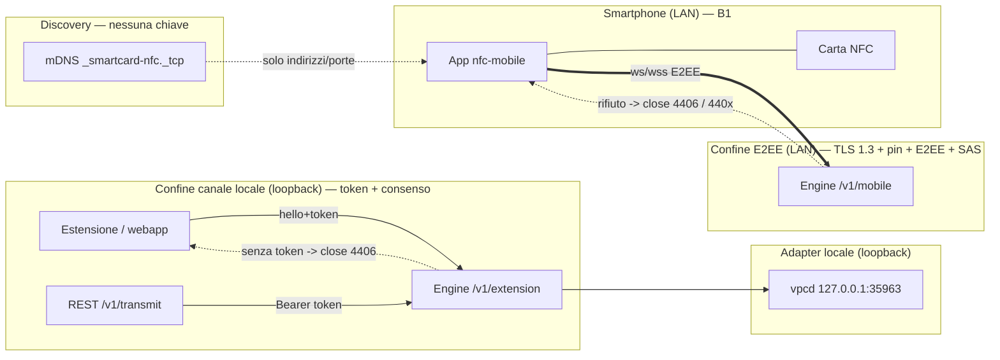
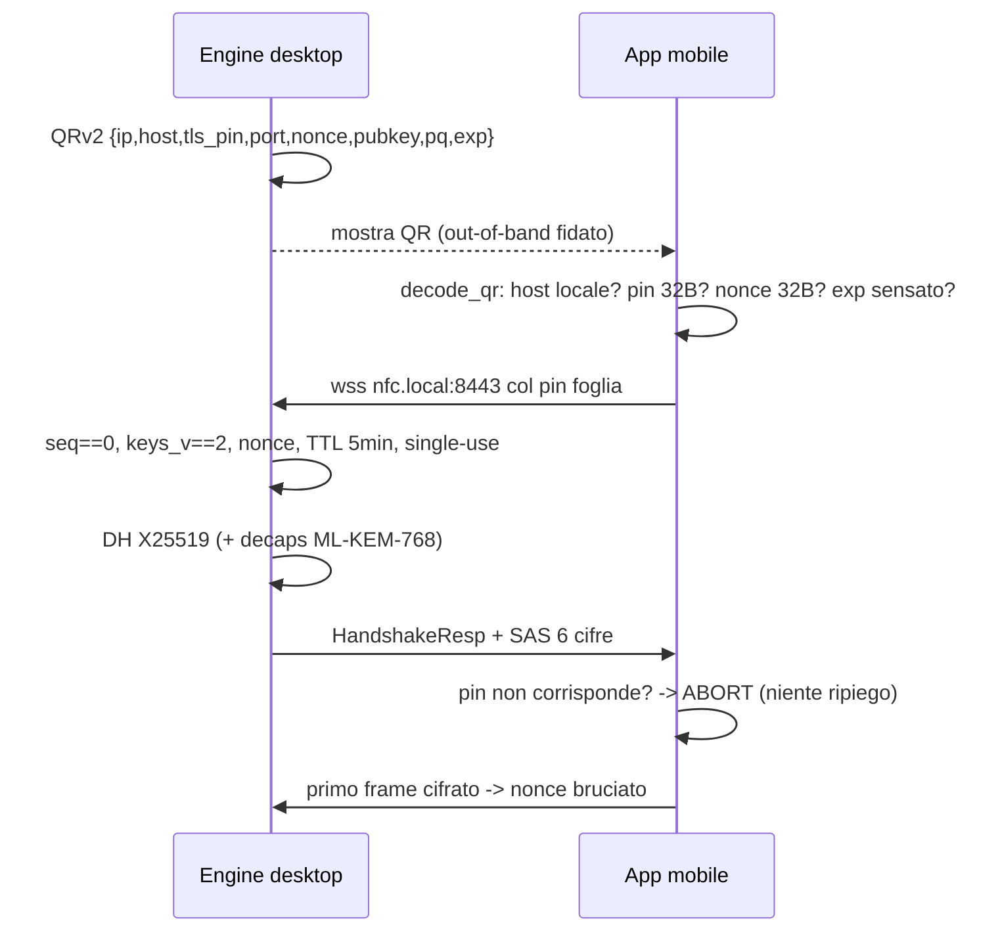

# Threat model — NFC Remote Smartcard

> Documento di threat model **formale e derivato dal codice**. Completa
> `docs/SECURITY.md` (che spiega il *perché* delle scelte e i flussi) e
> `docs/ARCHITECTURE.md` (che descrive il *cosa*): qui gli asset, i confini di
> fiducia, gli attori, l'analisi STRIDE per confine e la matrice
> **minaccia → controllo → evidenza**.
>
> Ogni controllo elencato è verificato nel sorgente (`file:riga`). I controlli
> che **non** esistono nel codice non sono inventati: sono elencati come
> **rischio residuo** (§6). Riferimenti incrociati: `docs/API_SPEC.md` (wire),
> `docs/LOCAL-DOMAIN.md` (PKI/domini), `docs/SECURITY.md` §1–§7.

---

## 1. Asset

| # | Asset | Dove vive nel codice | Perché conta |
|---|---|---|---|
| A1 | Chiavi di sessione E2EE (`k_m2d`, `k_d2m`) | `shared-core-rust/src/crypto.rs:86` (`ciphers`), derivate a `:140` | Compromissione = lettura/forgia di tutti gli APDU del canale mobile |
| A2 | Nonce QR 32B (salt HKDF + binding anti-MITM) | `shared-core-rust/src/pairing.rs:28`, bruciato a `desktop/src-tauri/src/ws_server.rs:1239` | Single-use: se riusato, un replay/MITM riapre una sessione |
| A3 | Token client locali | `desktop/src-tauri/src/local_auth.rs:104` (generazione), `:205` (solo SHA-256 a riposo) | Autorizza `/v1/extension` e `/v1/transmit` verso la carta |
| A4 | Pin TLS (SHA-256 del cert foglia) | `shared-core-rust/src/pairing.rs:63` (payload), `mobile/src-tauri/src/tls_pin.rs:62` (`expect`) | Unico ancoraggio di fiducia TLS del telefono (nessuna CA installata) |
| A5 | Identità reader/carta + codice APDU | `shared-core-rust/src/protocol.rs:117` (`apdu_bytes`), routing `desktop/src-tauri/src/ws_server.rs:211` | Dati di pagamento/identità CIE; la riservatezza è il fine ultimo |
| A6 | Chiave privata della CA/foglia locale | `desktop/src-tauri/src/local_tls.rs:305` (`ensure_pki`) | Rigenerarla sotto engine vivo rompe ogni pin (vedi §6) |
| A7 | Materiale di handshake (nonce + `used`) | `desktop/src-tauri/src/ws_server.rs:280`, `:347`–`:351` | Stato del confine E2EE: `used=true` chiude la finestra di pairing |

---

## 2. Confini di fiducia, attori e diagramma

### 2.1 Confini

| Confine | Meccanismo primario | Dove |
|---|---|---|
| **B1 — E2EE LAN** (`/v1/mobile`) | TLS 1.3 + pin foglia (dal QR) + E2EE `X25519`(+`ML-KEM-768`)/`AES-256-GCM` + SAS | `desktop/src-tauri/src/local_tls.rs:287`, `desktop/src-tauri/src/ws_server.rs:1157`, `mobile/src-tauri/src/tls_pin.rs:214` |
| **B2 — Canale locale** (`/v1/extension`, `/v1/transmit`) | loopback-only + allowlist Origin + **token per-client** con consenso tray (close `4406`) | `desktop/src-tauri/src/ws_server.rs:1015`, `:1440`, `desktop/src-tauri/src/local_auth.rs:235` |
| **B3 — Discovery mDNS** | `_smartcard-nfc._tcp` annuncia host/porte, **mai chiavi** | `shared-core-rust/src/mdns.rs:18`, `:65` |
| **B4 — Superfici web** (`/app`, `/pair`, `/v1/qr`, `/v1/metrics`) | allowlist Origin (letture); scritture anche loopback-only | `desktop/src-tauri/src/ws_server.rs:460`, `:504`, `:879` |
| **B5 — Adapter vpcd** (`127.0.0.1:35963`) | bind loopback + framing con limiti di lunghezza | `desktop/src-tauri/src/vpcd.rs:29`, `:105`, `:241` |

### 2.2 Attori

| Attore | Fiducia | Obiettivo |
|---|---|---|
| Mobile legittimo (app con QR) | autenticato dal materiale QR + SAS | leggere/scrivere la carta |
| Client locale autorizzato (estensione/webapp con token) | autenticato dal token | inoltrare APDU |
| Client locale **non** autorizzato (processo nel profilo) | non fidato | usare la carta o leggere lo stato |
| Host LAN ostile (ARP spoof / Evil Twin / MITM) | non fidato | impersonare engine o leggere APDU |
| Rete Wi-Fi (sniffer passivo, riordino pacchetti) | non fidato | intercettare/replay frame |
| Sito web malevolo (drive-by su loopback) | non fidato | leggere `/v1/qr`/`/v1/metrics`, innescare transmit |
| Processo locale privilegiato (root) | **fuori scope** (§6) | tutto |

### 2.3 Diagramma dei confini

### 2.4 Flusso di fiducia del pairing (attacco → controllo)

---

## 3. STRIDE per confine

Legenda controllo: `file:riga` verifica l'esistenza del controllo nel sorgente.

### 3.1 B1 — E2EE LAN (`/v1/mobile`)

| STRIDE | Minaccia concreta | Controllo | file:riga |
|---|---|---|---|
| S | Engine finto / Evil Twin che si presenta sulla LAN | TLS 1.3 + pin SHA-256 della foglia letto dal QR, confronto a tempo costante | `mobile/src-tauri/src/tls_pin.rs:78`, `:214` |
| S | MITM che rilancia l'handshake verso le due parti | SAS a 6 cifre mostrata su entrambi gli schermi (anti-MITM) | `shared-core-rust/src/crypto.rs:275`, `desktop/src-tauri/src/ws_server.rs:1218` |
| S | Impersonare il mobile senza il nonce del QR | Il nonce dell'init deve combaciare con quello emesso (altrimenti `4403`) | `desktop/src-tauri/src/ws_server.rs:1146` |
| T | Rimozione di `keys_v` dall'init per forzare materiale chiavi vecchio | Rifiuto con `4404` **prima** di bruciare il QR (niente downgrade) | `desktop/src-tauri/src/ws_server.rs:1118`, `shared-core-rust/src/protocol.rs:37` |
| T | Manomissione di un frame cifrato | Tag GCM 16B verificato ad ogni `open` | `shared-core-rust/src/crypto.rs:263` |
| R | Ripudio di aver inviato un APDU | Nonce deterministico `0x00000000||seq` + contatore; framing tracciato | `shared-core-rust/src/crypto.rs:217`, `:227` |
| I | Sniffer passivo sulla LAN legge gli APDU | Payload `AES-256-GCM` E2EE; trasporto TLS 1.3-only + `X25519MLKEM768` | `desktop/src-tauri/src/local_tls.rs:275`, `mobile/src-tauri/src/tls_pin.rs:231` |
| I | Furto del QR (shoulder surfing) per riusarlo | Nonce **single-use** bruciato solo a handshake riuscito + TTL 5 min | `desktop/src-tauri/src/ws_server.rs:1239`, `:355` |
| D | Frame enormi per esaurire la memoria del mobile | Limite frame 128 KB su entrambi i lati | `shared-core-rust/src/transport.rs:25`, `desktop/src-tauri/src/ws_server.rs:1354` |
| D | Handshake lasciato appeso | Timeout handshake 15s | `desktop/src-tauri/src/ws_server.rs:1420` |
| D | Riordino/replay Wi-Fi | Anti-replay: rifiuta `seq <= last_rx` e salti oltre +1024 | `shared-core-rust/src/crypto.rs:249`, `:255` |
| E | Downgrade forzato dal TLS al chiaro | Pin rifiutato → **abort** (il ripiego è solo per errori di rete) | `mobile/src-tauri/src/lib.rs:494`, `:455`, `mobile/src-tauri/src/tls_pin.rs:200` |
| E | Client legacy che riusa la chiave unica | `KEYS_V=2` obbligatorio; chiavi separate per direzione | `shared-core-rust/src/crypto.rs:65`, `:471` |

### 3.2 B2 — Canale locale (`/v1/extension`, `/v1/transmit`)

| STRIDE | Minaccia concreta | Controllo | file:riga |
|---|---|---|---|
| S | Qualunque processo locale si connette a `127.0.0.1:8080` | Token per-client: senza token valido, chiusura `4406` | `desktop/src-tauri/src/ws_server.rs:1440`, `:1574` |
| S | Sito web malevolo inietta `fetch` cross-origin su loopback | Allowlist Origin (+ CORS riflette la stessa allowlist, mai `*`) | `desktop/src-tauri/src/ws_server.rs:64`, `:408` |
| S | Replay di un token revocato per riaprire il consenso | Token invalido → `4406`, **nessun** downgrade al consenso | `desktop/src-tauri/src/ws_server.rs:1456` |
| T | Riuso di un token indistinto da "mai emesso" | Solo un `hello` **senza** token avvia il consenso; con token invalido si chiude | `desktop/src-tauri/src/ws_server.rs:1463` |
| R | Un client locale nega di aver inviato il comando | `last_seen_ms` per client + `request_id` nelle risposte/errori | `desktop/src-tauri/src/local_auth.rs:250`, `desktop/src-tauri/src/ws_server.rs:952` |
| I | Lettura del token a riposo (dump disco / backup) | A riposo solo `SHA-256(token)` in `clients.json` (0600) | `desktop/src-tauri/src/local_auth.rs:205`, `:330` |
| I | Timing side-channel sul confronto del token | Confronto a tempo costante XOR-fold (`constant_eq`) | `desktop/src-tauri/src/local_auth.rs:343`, `:240` |
| D | Flood di richieste di consenso | Massimo 8 pendenti, TTL 120s, una notifica per consenso | `desktop/src-tauri/src/local_auth.rs:174`, `:33` |
| D | Scritture impartite da host di rete (se il bind 8080 tornasse pubblico) | Scritture loopback-only **e** allowlist Origin (difesa in profondità) | `desktop/src-tauri/src/ws_server.rs:904`, `desktop/src-tauri/src/ws_server.rs:743` |
| E | Token revocato che riacquisisce accesso per inerzia | Revoca rimuove il record e persiste subito; il token non vale più | `desktop/src-tauri/src/local_auth.rs:273` |

### 3.3 B3 — Discovery mDNS

| STRIDE | Minaccia concreta | Controllo | file:riga |
|---|---|---|---|
| S | Responder mDNS finto che annuncia un engine ostile | mDNS **non** trasporta chiavi: l'identità resta legata al QR/E2EE | `shared-core-rust/src/mdns.rs:67` |
| T | Redirect del telefono verso un host scelto dall'attaccante | `host` del QR ristretto al dominio locale (`nfc.local` e sottodomini) | `shared-core-rust/src/pairing.rs:275`, `shared-core-rust/src/local_domain.rs:108` |
| I | mDNS diffonde IP/porta del desktop | Per design; il TXT annuncia solo `v/tls/pq/api`, nessun segreto | `shared-core-rust/src/mdns.rs:67` |
| I | Falsa porta in chiaro nel TXT (client tenta porta chiusa) | Il TXT non annuncia porte loopback-only | `shared-core-rust/src/mdns.rs:253` |
| D | Spoofing del responder per negare la scoperta | Impatto solo sulla scoperta; il pairing accetta anche l'IP nel QR | `shared-core-rust/src/pairing.rs:24` |

### 3.4 B4 — Superfici web (`/app`, `/pair`, `/v1/qr`, `/v1/metrics`)

| STRIDE | Minaccia concreta | Controllo | file:riga |
|---|---|---|---|
| I | Sito arbitrario fa `fetch` drive-by e legge QR/metriche | Allowlist Origin su `/v1/qr` e `/v1/metrics` (403 se negata) | `desktop/src-tauri/src/ws_server.rs:466`, `:885` |
| S | Client non-browser senza `Origin` accede alle letture | Origin assente ⇒ ammesso solo da loopback; LAN anonima ⇒ 403 | `desktop/src-tauri/src/ws_server.rs` (`is_allowed_read`) |
| T | Rigenerazione del QR da remoto (rotazione chiavi) | `POST /v1/qr` è loopback-only | `desktop/src-tauri/src/ws_server.rs:508` |
| T | Immissione di contenuto attivo nella webapp | CSP webapp: niente `unsafe-eval`, framing negato, `wasm-unsafe-eval` scoped | `desktop/src-tauri/src/ws_server.rs:657` |
| E | Lettura della webapp tramite Origin non in allowlist | Allowlist statica (extension, tauri, loopback, `*.nfc.local`) + dinamica LAN | `desktop/src-tauri/src/ws_server.rs:64`, `:126` |

### 3.5 B5 — Adapter vpcd (`127.0.0.1:35963`)

| STRIDE | Minaccia concreta | Controllo | file:riga |
|---|---|---|---|
| T | Frame vpcd malformato / lunghezza assurda | Limiti `1..=64*1024` su lunghezza e `len+4 == buf` | `desktop/src-tauri/src/vpcd.rs:105`, `:241` |
| T | APDU di lunghezza fuori range | APDU accettata solo `4..65535` byte | `desktop/src-tauri/src/vpcd.rs:182`, `shared-core-rust/src/protocol.rs:126` |
| I | Esposizione dell'adapter in rete | Bind su `127.0.0.1:35963` (mai esposto) | `desktop/src-tauri/src/vpcd.rs:29` |
| D | Allocazione illimitata dal demone | Cap di lunghezza prima dell'allocazione | `desktop/src-tauri/src/vpcd.rs:106` |
| E | Accesso di un processo locale al vpcd | Nessuna auth (loopback); vedi §6 (residuo) | `desktop/src-tauri/src/vpcd.rs:29` |

---

## 4. Matrice minaccia → controllo → evidenza

Colonna "Evidenza": test in `desktop/src-tauri/tests/*`, unit test di
`shared-core-rust`/`mobile`/`nfc-core-wasm`, il guard
`scripts/guard-security-2026.sh` e i target `fuzz/fuzz_targets/*`.

| ID | Minaccia | Controllo | file:riga | Evidenza |
|---|---|---|---|---|
| M01 | Engine finto in LAN | Pin TLS foglia + TLS1.3 | `mobile/src-tauri/src/tls_pin.rs:78` | `tls_pin` test `:309` / guard `:67`-`:72` |
| M02 | MITM relay | SAS 6 cifre | `shared-core-rust/src/crypto.rs:275` | `crypto` test `hybrid_differs_from_classic:531` |
| M03 | Nonce QR errato | Confronto nonce init/emesso | `desktop/src-tauri/src/ws_server.rs:1146` | `desktop/src-tauri/tests/handshake.rs:114` `nonce_non_appartenente_al_qr_rifiutato` |
| M04 | Downgrade materiale chiavi | `keys_v==KEYS_V` rifiuto 4404 | `desktop/src-tauri/src/ws_server.rs:1118` | `desktop/src-tauri/tests/handshake.rs:95` `client_legacy_rifiutato_con_codice` |
| M05 | Tamper frame | Tag GCM ad ogni open | `shared-core-rust/src/crypto.rs:263` | `crypto` `roundtrip_e_replay:443` |
| M06 | Replay/reorder | `seq <= last_rx` rifiutato | `shared-core-rust/src/crypto.rs:249` | `crypto` `roundtrip_e_replay:443` |
| M07 | Salto seq anomalo | `seq > last_rx+1024` rifiutato | `shared-core-rust/src/crypto.rs:255` | `crypto` `:443` |
| M08 | Riposo chiavi diverse per direzione | HKDF 64B split + `Direction` | `shared-core-rust/src/crypto.rs:155` | `chiavi_separate_per_direzione:471` |
| M09 | Sniffer LAN | E2EE AES-256-GCM + TLS1.3 PQ | `desktop/src-tauri/src/local_tls.rs:275` | `local_tls` `:439` / guard `:75`-`:82` |
| M10 | Furto QR | Nonce single-use + TTL 5min | `desktop/src-tauri/src/ws_server.rs:1239` | `desktop/src-tauri/tests/handshake.rs:141` `handshake_completo_e_qr_single_use` |
| M11 | Handshake appeso | Timeout 15s | `desktop/src-tauri/src/ws_server.rs:1420` | `desktop/src-tauri/tests/handshake.rs:37` (engine E2E), `desktop/src-tauri/tests/handshake.rs:234` `handshake_oltre_il_cap_respinto_con_503` (cap concorrenza) |
| M12 | Frame gigante | Cap 128 KB | `shared-core-rust/src/transport.rs:25` | guard `:107` (bind) / `fuzz/wire_frame.rs` |
| M13 | Downgrade TLS→chiaro | Abort su pin rifiutato | `mobile/src-tauri/src/lib.rs:494` | `mobile/src-tauri/src/lib.rs:1020` `rifiuto_del_pin_non_ripiega_mai_in_chiaro` |
| M14 | Processo locale estraneo | Token per-client | `desktop/src-tauri/src/ws_server.rs:1440` | `desktop/src-tauri/tests/extension_auth.rs:63` `hello_senza_token_consenso_e_token_consegnato` |
| M15 | Sito malevolo drive-by | Allowlist Origin + CORS | `desktop/src-tauri/src/ws_server.rs:64` | `desktop/src-tauri/tests/api.rs:361` `origin_non_allowlist_403`, `desktop/src-tauri/tests/api.rs:390` |
| M16 | Token revocato riapre consenso | 4406 senza downgrade | `desktop/src-tauri/src/ws_server.rs:1456` | `desktop/src-tauri/tests/extension_auth.rs:117` `token_sconosciuto_chiude_4406_senza_degradare` |
| M17 | Token leggibile a riposo | Solo SHA-256, file 0600 | `desktop/src-tauri/src/local_auth.rs:205` | `local_auth` `persistenza_roundtrip_su_disco:429` / guard `:85`-`:92` |
| M18 | Timing sul token | `constant_eq` XOR-fold | `desktop/src-tauri/src/local_auth.rs:343` | guard `:89` (XOR-fold di `constant_eq`) |
| M19 | Flood consenso | Max 8 pendenti + TTL 120s | `desktop/src-tauri/src/local_auth.rs:174` | `local_auth` `:359`,`:379` |
| M20 | Revoca non effettiva | `revoke` rimuove e persiste | `desktop/src-tauri/src/local_auth.rs:273` | `local_auth` `revoca_invalida_il_token:395` |
| M21 | Scritture da rete se bind pubblico | loopback-only + Origin | `desktop/src-tauri/src/ws_server.rs:904` | `desktop/src-tauri/tests/api.rs:330` `scritture_rest_solo_loopback_anche_se_il_bind_e_pubblico` |
| M22 | REST senza token | `Bearer` + 401 | `desktop/src-tauri/src/ws_server.rs:920` | `desktop/src-tauri/tests/api.rs:104` `transmit_senza_token_401`, `:129` / guard `:103` |
| M23 | Bind in chiaro pubblico | Bind hard-coded 127.0.0.1 | `desktop/src-tauri/src/ws_server.rs:743` | `desktop/src-tauri/tests/api.rs:289` `piano_in_chiaro_e_loopback_only` / guard `:107`-`:110` |
| M24 | Host QR fuori dominio | Rifiuto host non locale | `shared-core-rust/src/pairing.rs:275` | `shared-core-rust/src/pairing.rs:429` `host_fuori_dominio_locale_rifiutato` |
| M25 | Pin TLS malformato | Rifiuto pin non 32B | `shared-core-rust/src/pairing.rs:283` | `shared-core-rust/src/pairing.rs:414` / `mobile/src-tauri/src/tls_pin.rs:262` |
| M26 | TLS incompleto (host senza pin) | Criterio "tutto o niente" | `mobile/src-tauri/src/lib.rs:227` | `shared-core-rust/src/pairing.rs:528` `tls_incompleto_non_abilita_il_canale` |
| M27 | QR malformato/corrotto | Validazione prefisso/base64/JSON/lunghezze | `shared-core-rust/src/pairing.rs:210` | `fuzz/pairing_qr.rs` / `nfc-core-wasm` `:144` |
| M28 | Scadenza QR assurda | Range `EXP_MIN_SANE..=EXP_MAX_SANE` | `shared-core-rust/src/pairing.rs:299` | `shared-core-rust/src/pairing.rs:511` `scadenza_assurda_rifiutata` |
| M29 | Drive-by su QR/metriche | Origin-only su letture | `desktop/src-tauri/src/ws_server.rs:466`, `:885` | `desktop/src-tauri/tests/api.rs:390` `qr_e_metrics_leggibili_da_lan_ma_bloccati_drive_by` |
| M30 | Rotazione PKI sotto engine vivo | `--rotate-ca` rifiutato con engine attivo (`engine.lock` + porta TLS occupata) | `desktop/src-tauri/src/local_tls.rs:107` | `desktop/src-tauri/tests/rotate_ca.rs:45` `rotate_ca_rifiuta_solo_con_un_engine_vivo` |
| M31 | Frame prost malformato | Decoder ritorna `Err`, mai panic | `shared-core-rust/src/protocol.rs:50` | `fuzz/wire_frame.rs` |
| M32 | Frame vpcd malformato | Cap lunghezza vpcd | `desktop/src-tauri/src/vpcd.rs:241` | `fuzz/vpcd_frame.rs` / `vpcd_stub_roundtrip.rs` |
| M33 | Webapp con eval generico | CSP senza `unsafe-eval`, `wasm-unsafe-eval` scoped | `desktop/src-tauri/src/ws_server.rs:657` | `ws_server::tests` `csp_ammette_il_wasm_e_solo_il_wasm:1725` / guard `:142` |
| M34 | QR validato lato JS (regressione) | Deve passare dal core WASM | `web/src/main.ts:139` | guard `:150` (`parsePairingQr`) / `nfc-core-wasm` `:144` |
| M35 | Rotazione chiavi senza QR | `rekey` key-feedback su `k_m2d` | `shared-core-rust/src/crypto.rs:191` | `crypto` `rekey_riallinea_le_due_direzioni:511` |

**Totale righe matrice: 35.** Controlli mappati a un'evidenza automatizzata
reale (test Rust, guard a grep, o target fuzz): **35/35** — nessuna riga poggia
su un controllo non verificato. In dettaglio: **24** hanno un test Rust
dedicato, **13** sono coperti anche dal guard `scripts/guard-security-2026.sh`,
**3** hanno un target fuzz (`pairing_qr`, `wire_frame`, `vpcd_frame`).

---

## 5. Proprietà non osservabili dai test (coperte da guard)

Alcune proprietà cross-crate non sono esprimibili in un test unitario e sono
verificate **a grep** da `scripts/guard-security-2026.sh`:

- TLS 1.3-only nei due grafi: guard `:67`-`:72` (clausola
  `with_protocol_versions(&[&rustls::version::TLS13])`).
- KEX ibrido PQ (`prefer-post-quantum` + `aws-lc-rs`) nei Cargo: guard `:75`-`:82`.
- SHA-256 + tempo costante + `0600` + consenso esplicito: guard `:85`-`:94`.
- `4406` stabile e usato + `Bearer` sul REST: guard `:97`-`:104`.
- Bind in chiaro loopback + handler che rifiutano non-loopback: guard `:107`-`:110`.
- Default `requireHttps=true` + `hello+token` + `consent_status` + pulizia su `4406`
  nell'estensione: guard `:113`-`:123`.
- MIME `application/wasm` + CSP `wasm-unsafe-eval` + `parsePairingQr` webapp:
  guard `:140`-`:153`.

Motivo (dal commento del guard stesso, `scripts/guard-security-2026.sh:6`-`:12`):
una rinomina rimuoverebbe la differenza fra client autorizzato ed estraneo
**senza** errore di compilazione, perché i confini del canale locale sono
stringhe JSON.

---

## 6. Rischi residui e fuori scope

### 6.1 Rischi residui (documentati; mitigazioni parziali a codice)

1. **Letture LAN con `Origin` falsificabile.** `/v1/qr` e `/v1/metrics` sono
   leggibili dalla LAN; il guard è l'`Origin`
   (`OriginPolicy::is_allowed_read`, `desktop/src-tauri/src/ws_server.rs`). Un
   `Origin` assente è ammesso **solo** da loopback (curl, webapp same-origin);
   un client LAN anonimo è respinto (403). Residuo: un client **nativo** sulla
   LAN può forgiare un `Origin` in allowlist — l'`Origin` è un controllo
   anti-drive-by del browser, non un'autenticazione. La chiusura piena
   richiederebbe il token anche sulle letture.
2. **Fallback 8080 in chiaro verso la carta.** Su una postazione con
   `requireHttps=false`, un processo locale privilegiato può sniffare il
   proprio loopback. Il token alza il costo ma non elimina il vettore
   (`docs/SECURITY.md` §7). Default resta `requireHttps=true`
   (`browser-extension/src/background/service-worker.ts:36`).
3. **vpcd senza autenticazione.** L'adapter su `127.0.0.1:35963` non richiede
   credenziali (`desktop/src-tauri/src/vpcd.rs:29`): un processo locale può
   pilotarlo. Confine accettato perché loopback-only.
4. **Discovery mDNS non autenticata.** Un responder ostile può alterare la
   *scoperta* (non l'identità): l'autenticazione resta il QR + E2EE. Nessun
   segreto è annunciato (`shared-core-rust/src/mdns.rs:67`).
5. **Handshake: cap di concorrenza, non rate-limit per-IP.** Le negoziazioni
   `/v1/mobile` in corso sono limitate a `HANDSHAKE_MAX_CONCURRENT` (= 8): il
   permesso è rilasciato appena l'handshake termina (ok o errore) e l'eccesso
   riceve 503 (`desktop/src-tauri/src/ws_server.rs`; contatore
   `nfc_handshake_rejected_total` in `desktop/src-tauri/src/metrics.rs`).
   Residuo: non c'è un token-bucket per-IP né una penalità dopo N fallimenti;
   un attaccante entro il cap può ritentare, ma ogni tentativo costa il timeout
   di 15 s e non consuma il nonce del QR finché non riesce.
6. **Risoluzione di `nfc.local`.** Il nome può essere intercettato dal resolver
   di sistema (systemd-resolved); il ripiego è `https://localhost:8443` o lo
   script rootless. Rischio operativo, non di protocollo (`AGENTS.md`).
7. **WebRTC fallback host-only.** I candidati ICE sono solo `host` (nessuno
   STUN/TURN pubblico di default) e il DataChannel trasporta gli stessi
   `EncryptedFrame` E2EE (`shared-core-rust/src/protocol.rs:161`). Il rifiuto
   dei candidati `srflx`/`relay` e il 501 senza feature `webrtc` sono ora
   coperti da test in `desktop/src-tauri/src/webrtc_fallback.rs`
   (`candidato_non_host_respinto`, `offerta_senza_feature_risponde_501`).

### 6.2 Fuori scope

- **Device mobile compromesso** (root/jailbreak): le chiavi di sessione
  esistono in chiaro nel processo dell'app; nessun controllo del protocollo le
  protegge da un OS ostile.
- **Processo locale privilegiato / root** e malware kernel-level.
- **Coercizione fisica** dell'utente (approvazione del consenso o conferma SAS
  sotto minaccia).
- **Sicurezza intrinseca del chip CIE / PACE**: il canale trasporta APDU
  opachi e non interferisce con Secure Messaging interno.
- **Canale di distribuzione** (store delle estensioni, supply chain delle
  dipendenze oltre il lockfile).
- **Side-channel fisici** (power/EM) sul dispositivo.

---

## 7. Riferimenti incrociati

| Tema | Documento |
|---|---|
| Modello di sicurezza e rationale | `docs/SECURITY.md` |
| Architettura e crate graph | `docs/ARCHITECTURE.md` |
| Wire protocol | `docs/API_SPEC.md` |
| Domini, CA, SAN | `docs/LOCAL-DOMAIN.md` |
| Invarianti a grep | `scripts/guard-security-2026.sh` |
